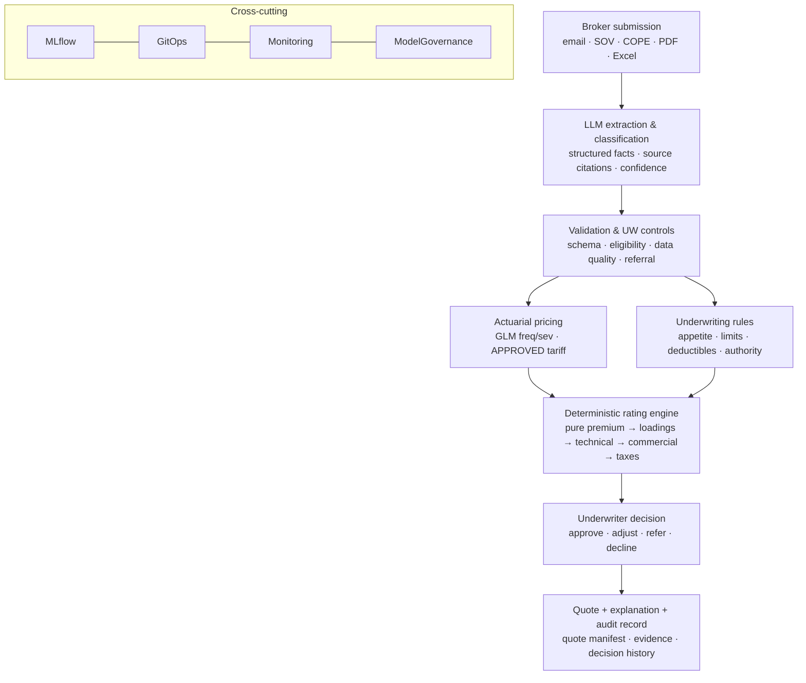

# Actuarial Pricing Evolution — Design Blueprint (Underwriting & Pricing #12)

> **Status: Proposed / Draft — for review.** Owner: SA/TL. This is the SA design record for evolving
> pricing from the v1 hand-set factor tariff into a statistically-grounded, governed, explainable
> actuarial pricing capability — **without** redesigning the application. It is the detail behind
> **[ADR-009](./adr/000-index.md#adr-009)** and extends **ADR-003** (AI assistive + human-verified),
> **ADR-004** (versioned/immutable tariffs), **ADR-007** (Python/FastAPI). Cert evidence: BC02
> (concevoir) · BC03 (coordonner & piloter).
>
> Scope note: this is an **engineering design**, not a formal actuarial or regulatory sign-off. It is
> deliberately actuarially *framed* so the real actuarial work (model selection, validation, approval)
> has a correct home.
>
> **Implemented so far (2026-10-21): P0 + P1 live on dev** (story UW-04-S02). The pure `rate()` engine now
> produces the **staged build-up** (loss cost → technical → commercial → taxes) with each `LineItem`
> tagged by `stage`; a **v2 rate table** carries the loading stack (expense 15% · risk/capital 6% · CAT
> 4% · commercial-adjustment band ±15% · IPT 9% · €50 fee, all simulation/indicative); the **quote
> manifest** (staged subtotals + input facts) is persisted → a quote is legible AND replayable. Backward-
> compatible (a v1 table prices exactly as before). P2–P6 below remain future work.

## 1. Problem & the one governing principle

v1 prices with a **pure, deterministic factor engine** (`app/rating/engine.py::rate()`): a versioned
rate table (ADR-004) of hand-set relativities, producing an explainable `QuoteBreakdown` (ordered
`LineItem` trail, eurocents, round-once). It is correct and auditable — but the relativities are
*guessed*, not *estimated from experience*, and the premium build-up is not actuarially complete.

We evolve it under one rule:

> **A model is a black box in _training_, never in _pricing_.** Any GLM/GBM is trained offline and
> **compiled into an approved tariff** (relativities + rules) that flows through the *same* pure,
> deterministic, versioned rating engine. The quoted price is always a product/sum of named,
> inspectable steps — never a live model call. The price must be reconstructable **independently of
> any model or LLM.**

The payoff: `rate(facts, approved_tariff) -> QuoteBreakdown` barely changes shape. What changes is
*where the tariff comes from* (hand-set → GLM-derived → approved) and *how complete the trail is*.

## 2. Three layers — do not conflate them

The loss model, the approved tariff, and the rating engine are **distinct components with distinct
owners** (this is the key correction over the first sketch):

```
┌─ Loss model (actuary/DS, OFFLINE) ──────────────────────────────┐
│  GLM frequency × severity (+ large/CAT models). Estimates the    │
│  EXPECTED LOSS COST of a risk. Lives in MLflow. Never called at  │
│  quote time.                                                     │
└───────────────┬──────────────────────────────────────────────────┘
                │  compile + INDEPENDENT VALIDATION + ACTUARIAL SIGN-OFF
                ▼
┌─ Approved tariff artifact (governed, versioned, immutable) ──────┐
│  The COMPLETE governed object — not just coefficients:           │
│  relativities · base rates · loading parameters · ROUNDING rules │
│  · EFFECTIVE DATES · AUTHORITY bands · commercial-adjustment ctrl │
└───────────────┬──────────────────────────────────────────────────┘
                │  published (GitOps-governed), loaded by the engine
                ▼
┌─ Rating engine (deterministic, pure — app/rating) ───────────────┐
│  ENFORCES the approved tariff: computes the premium build-up,    │
│  applies rounding/effective-dating/authority, emits the LineItem │
│  trail + the quote manifest. No model, no I/O in the core.       │
└──────────────────────────────────────────────────────────────────┘
```

Why it matters: when a model is **retrained**, only the loss-model layer moves; a new tariff is
*derived, validated, approved, and published* — the engine's enforcement logic (rounding, authority,
dating) does **not** silently change. "The GLM changed" can never, by construction, change how a
premium is rounded or who was allowed to bind it.

## 3. End-to-end underwriting workflow (the thing worth building)

Pricing is one station on a line; the business value is the whole line:



Target scenario (the demo that proves business capability, not ML): *broker submits an industrial
risk → platform extracts & validates facts → transparent GLM-derived technical premium → underwriting
rules → exceptional cases referred to a human → a fully reproducible quote.*

## 4. The corrected premium build-up

v1 collapses everything into `base × occupancy × adjustments`. The actuarial build-up separates the
**technical** premium from the **commercial** premium, and each step stays a `LineItem`:

```
EXPECTED LOSS COST  (the loss model's output — NOT hand-set)
    Exposure × E[frequency] × E[severity]
      frequency GLM: Poisson/NegBin, log link, EXPOSURE OFFSET
      severity  GLM: Gamma/log-normal, log link
      (corporate property: model ATTRITIONAL, LARGE and CAT losses separately —
       one GLM does not capture tail/CAT behaviour)
= PURE PREMIUM                           "expected insured loss cost"
    + expense loading                    (acquisition + admin)
    + risk margin / cost-of-capital      (volatility, Solvency-II flavour)
    + CAT provision                      (modelled separately; portfolio-informed)
= TECHNICAL INDICATION                   "the risk's defensible cost to us"
    × commercial adjustment (bounded, logged, authority-gated)
    ± underwriter judgement (referral lane only)
= COMMERCIAL (OFFICE) PREMIUM            "what we offer"
    + taxes (IPT, jurisdiction-dependent) + fees
= FINAL QUOTED PREMIUM
```

**Reinsurance is NOT a per-risk discount** (correction over the first sketch). Ceded premium, retained
loss, recoveries and CAT loadings must be treated consistently at the **portfolio/capital** level — they
shape the **CAT provision** and the **cost-of-capital margin**, not a flat credit subtracted from one
risk's premium. Treating a reinsurance recovery as a line-item discount risks underpricing or
double-counting the same benefit.

## 5. Explainability — preserved by design

- **GLM = multiplicative relativities.** A log-link GLM's coefficients exp(β) **are** multiplicative
  relativities — exactly the shape the engine already renders (`occupancy:warehouse ×1.25`). So a GLM
  drops into the existing `RateTableSpec.occupancy_factors` / `adjustments` structure and the
  `LineItem` trail survives *for free*. A ×1.25 stops being a guess and becomes `exp(β_warehouse)`
  learned from experience, but lands in the identical breakdown.
- **SHAP is NOT premium arithmetic** (correction over the first sketch). SHAP explains a *model
  prediction* relative to a baseline/background distribution and an output scale — it is **model
  governance + validation** (is a factor behaving plausibly? is it a proxy for something prohibited?),
  **not** a contractual premium adjustment. SHAP never appears in the customer-facing quote breakdown.
  The breakdown shows the **approved tariff arithmetic** only.
- **Consequence → GLM-first.** Because a GLM is natively a legible tariff and a GBM is not, we **start
  with frequency/severity GLMs** and only introduce a GBM when experiments demonstrate **material**
  lift — and then only via a separately-governed, reproducible translation into tariff terms, in a
  refer/triage lane, never as a raw-SHAP price.

## 6. Governed model lifecycle — registered ≠ approved

A model in the registry is a **candidate**; only a **signed-off tariff** is publishable. Insert explicit
validation + actuarial approval between training and production (extends ADR-004):

1. **Data preparation** — claims, exposure, policy terms, inflation/trend adjustment, data quality.
2. **Model training** — GLM fitting, feature engineering, diagnostics (lift, Gini, A-vs-E by factor).
3. **Independent validation** — out-of-time test, calibration, stability, **bias/proxy** checks, segment
   performance. A different pair of eyes than the trainer.
4. **Actuarial approval** — review + sign-off of the selected tariff (a named human gate, recorded in
   the RACI — this is a governance-gate decision, the BC01/BC03 seam).
5. **Immutable publication** — versioned coefficients **+ rules + effective dates + rounding + authority**
   as one artifact (ADR-004). Registered in **MLflow**; published as the engine's tariff version.
6. **Controlled deployment** — GitOps promotion, regression tests, rollback; champion/challenger by label.
7. **Production monitoring** — actual-vs-expected loss ratio by segment, factor drift, data drift,
   referral/override rates → the platform alerting/SDLC loop.

## 7. Reproducibility — the quote manifest (replay any historical quote)

Stamping `rate_table_version` alone is insufficient. Every quote persists an immutable, content-addressed
**quote manifest**:

```
quote_manifest = {
  model_version, approved_tariff_version, ruleset_version,
  commercial_adjustment_version, effective_date,
  input_facts (the exact RatingFacts priced),
  evidence_refs (extraction source docs + locations),
  breakdown (the full LineItem trail), premium_minor, actor
}
```

This enables the enterprise capability: **replay a historical quote exactly as it was calculated, even
after the model has been replaced.** Same immutability discipline the platform already applies to
container images (cosign/SBOM), applied to a price. This is where the platform's GitOps/immutability
engineering pays off directly.

## 8. LLM roles — and the hard boundary

**The boundary (non-negotiable): an LLM never computes the premium and is never the rating function.**
It is non-deterministic, not reproducible for an audit, and not defensible to a regulator as a tariff.
Keeping the LLM *out of the price* is itself the senior design decision. Within that boundary the LLM
adds real value **around** the engine (all via the platform LLMOps golden path — LiteLLM gateway,
per-product Langfuse tracing, Presidio DLP, evals, human-in-the-loop; ADR-003 governs it):

1. **Submission extraction → structured facts (highest operational value).** Broker emails, SOV
   spreadsheets, COPE/surveyor reports → structured `RatingFacts` the deterministic engine prices.
   Each extracted value **links to a source document + location** (evidence-grounded). **Do not trust
   the model's own confidence alone** — gate with schema validation, deterministic consistency checks,
   source grounding, and **human review for material uncertainty**; missing/conflicting facts are
   resolved or referred **before** binding pricing. Workflow: *submission → extraction → verification →
   pricing → underwriter decision → quote.*
2. **Explanation narration** — verbalise the deterministic `LineItem` trail for broker/underwriter,
   grounded strictly in the breakdown + guidelines (cannot invent numbers).
3. **Underwriter copilot (guideline RAG)** — answer appetite/authority questions, surface comparables;
   suggests, the human decides (UW-03 seam).
4. **Data-quality / anomaly flags** — surface incoherent submissions for review before pricing.
5. **Model-governance assist** — draft the model card, summarise drift / A-vs-E reports, explain factor
   changes between versions. Documentation, not decisions.

Mental model: *LLM (understand the messy world) → structured facts → deterministic GLM-derived engine
(compute & explain the price) → LLM (narrate). AI on both ends; a transparent, auditable actuarial core
in the middle.*

## 9. Regulatory classification — an artifact, not a hardcoded label

The EU AI Act specifically flags AI for risk assessment/pricing in **life & health insurance for natural
persons** as high-risk. We do **not** auto-label every B2B P&C model "limited-risk": classification
depends on the actual system, its function, and whether it meets the AI-system definition. So we
implement a **documented per-use-case classification + model-risk assessment** (reusing the platform's
`ai-act-gate`), re-evaluated per system — not a config string. Per **EIOPA's Aug-2025 opinion**, the core
governance obligations (recordkeeping, fairness, explainability, security, human oversight) apply
**beyond** AI-Act high-risk anyway — and this design already provides them (immutable tariffs, the quote
manifest, GLM explainability, human-in-the-loop, monitoring).

## 10. Options & trade-offs

| Option | Pros | Cons | Call |
|---|---|---|---|
| **Freq/severity GLMs** (chosen first) | legible multiplicative tariff; actuarially standard; drops into the existing trail; validatable | less raw predictive power than GBM on rich data | **Adopt (P3)** |
| Tweedie single GLM (pure premium) | one model, simpler | hides freq vs severity drivers; weaker for CAT/large | later/alt |
| GBM + SHAP | highest predictive lift | not a legible tariff; SHAP ≠ price; heavy governance | **P6 only, if material lift, refer-lane** |
| LLM/ML directly behind `calculatePremium()` | — | non-deterministic, unauditable, indefensible | **Rejected** |

## 11. Roadmap (adopted from the review)

Priority is the **end-to-end workflow over fancier algorithms.** Once the workflow is reliable, pricing
models evolve without redesigning the app.

| Pri | Capability | Why |
|---|---|---|
| **P0** | Deterministic engine + **full audit/quote manifest** | foundational correctness + replay — ✅ **done (dev, UW-04-S02)** |
| **P1** | **Technical vs commercial** premium separation (+ taxes/fees) | actuarial clarity, pure-engine work, no ML — ✅ **done (dev, UW-04-S02)** |
| **P2** | **LLM submission extraction + human validation** | immediate operational value; model-independent |
| **P3** | Synthetic exposure/claims simulation + **freq/severity GLMs** | statistical pricing (factor-recovery proof) |
| **P4** | **Model registry + approval workflow + controlled publication** | production governance (registered ≠ approved) |
| **P5** | Portfolio monitoring, drift, A-vs-E analytics | lifecycle management |
| **P6** | GBM experimentation, champion/challenger | advanced optimisation, only if it earns it |

## 12. Consequences, risks, deliberate non-goals

- **Synthetic data proves methodology, not a tariff.** The simulator can show a GLM **recovers the
  factors it injected** — this is explicitly **not** a validated real-world corporate tariff. Stated
  honestly wherever results are shown (synthetic-enterprise disclaimer).
- **More governance surface** (validation + actuarial sign-off gates, the quote manifest) — accepted; it
  is the point.
- **Deliberately deferred:** GBM/ML in the price path (P6, gated on lift); autonomous AI action (ADR-003,
  parked); MDM-sourced entities (ADR-002); real external claims data (out of scope for a lab).
- **The pure `rate()` seam is preserved** throughout — every phase adds around it; none rewrites it.

## Links
- Decision record: [ADR-009](./adr/000-index.md#adr-009) · supports ADR-003, ADR-004, ADR-007.
- `solution-architecture.md` · `nfr-register.md` (EXP/AUD NFRs) · `threat-model.md` (T2 mispricing).
- Platform standards referenced, not restated: `llmops.md`, `ai-act-gate`, `reliability-and-gamedays.md`.
